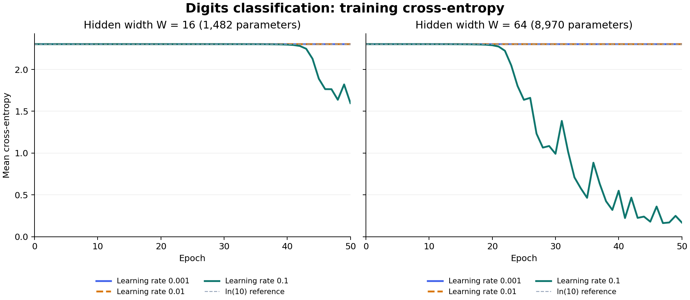

# Lab 2: A neural network from scratch

## 1. Goal

Design and implement a two-hidden-layer classifier using explicit NumPy forward propagation and chain-rule backpropagation. Verify its softmax probabilities, cross-entropy and analytical gradients, compare the required learning rates and hidden widths on handwritten digits, and measure forward/backward latency separately.

## 2. Method

The built-in `load_digits` dataset contains 1,797 samples: flattened 8-by-8 images with 64 pixel inputs and labels 0 through 9. Inputs are divided by 16, yielding values in [0, 1]; labels are encoded as 10-column one-hot vectors. A stratified 70/30 split with random_state=42 gives 1,257 training and 540 test examples. Pixel scaling is a fixed rule and learns no test-set statistics. The test partition is used only for final evaluation.

### Network design and dimensions

Both hidden layers use the same width W, tested at 16 and 64:

```text
64 inputs -> affine -> W -> ReLU -> affine -> W -> ReLU -> affine -> 10 -> softmax
```

| Parameter | General shape | W = 16 | W = 64 |
|---|---|---|---|
| W1 | (64, W) | (64, 16) | (64, 64) |
| b1 | (W,) | (16,) | (64,) |
| W2 | (W, W) | (16, 16) | (64, 64) |
| b2 | (W,) | (16,) | (64,) |
| W3 | (W, 10) | (16, 10) | (64, 10) |
| b3 | (10,) | (10,) | (10,) |
| Trainable scalars | 64W + W^2 + 12W + 10 | 1,482 | 8,970 |

Weights use independent normal draws with mean 0 and standard deviation 0.01: `rng.normal(0, 0.01, shape)`. This explicitly states the NumPy scale convention used for the manual's N(0, 0.01). Biases start at zero. The initialization seed is 42. All calculations use float64. For a fixed width, all three learning rates start from identical parameters and use the same sequence of shuffled training rows.

### Forward pass, loss and analytical derivation

For a batch of m row vectors, the layer equations are:

```text
Z1 = X @ W1 + b1             A1 = max(Z1, 0)
Z2 = A1 @ W2 + b2            A2 = max(Z2, 0)
Z3 = A2 @ W3 + b3            P  = softmax(Z3)
```

Biases broadcast across rows. Softmax subtracts each row's maximum before exponentiation. Its output has shape (m, 10), and each row must sum to 1 within 1e-6. Mean cross-entropy is `L = -(1/m) * sum_i sum_k Y[i,k] * log(P[i,k])`. It is evaluated using stable log-sum-exp from logits, preserving finite losses without clipping probabilities. Uniform probabilities give `L = ln(10) = 2.302585...`; the randomly initialized network should be close to that value.

To derive the output gradient, softmax has derivative `dP[j]/dZ[k] = P[j] * (delta[j,k] - P[k])`, while cross-entropy contributes `dL/dP[j] = -Y[j]/(m*P[j])`. Summing their chain-rule products and using `sum_j Y[j] = 1` gives `dZ3 = (P - Y)/m`. Applying the affine-layer rule and the ReLU indicator at each preceding layer gives:

```text
dZ3 = (P - Y) / m
dW3 = A2.T @ dZ3            db3 = sum(dZ3, axis=0)
dZ2 = (dZ3 @ W3.T) * (Z2 > 0)
dW2 = A1.T @ dZ2            db2 = sum(dZ2, axis=0)
dZ1 = (dZ2 @ W2.T) * (Z1 > 0)
dW1 = X.T @ dZ1             db1 = sum(dZ1, axis=0)
```

Every gradient matches its parameter's shape. ReLU's derivative is zero at zero. The normalization by m occurs once, at dZ3, and uses the actual batch size, including the final batch of 9 records. SGD applies `parameter -= learning_rate * gradient`. No automatic differentiation or neural-network training library is used.

For each width, numerical checking uses the first 16 training rows and 10 weights drawn uniformly without replacement from the union of W1, W2 and W3 with random_state=42. Biases are excluded from this required random-weight sample and are covered by separate unit tests. Each selected weight is perturbed by +1e-5 and -1e-5, giving `(L(w+h)-L(w-h))/(2h)`. Relative error is `abs(analytic-numerical)/max(1e-12, abs(analytic)+abs(numerical))`; a weight passes only if this is strictly below 1e-6. At least 9/10 must pass for each width. Indices are selected before inspecting derivatives, all comparisons are retained, and parameters are restored after checking.

Training uses shuffled mini-batches of 32 for 50 epochs, learning rates [0.001, 0.01, 0.1], and widths [16, 64]. Each epoch has 40 updates (39 batches of 32 and one of 9). The shuffle generator resets to seed 42 for each configuration. Full-training loss and accuracy are computed after each epoch, producing 300 logged rows. The test set is not used for epoch logging, stopping or hyperparameter selection; all six predefined test results are reported.

Pass timings use the trained model and a fixed batch of 32 training examples. Forward and backward each have 20 warm-up calls followed by 100 individually timed calls; medians use `perf_counter_ns`. Forward includes activations, softmax and cache construction. Backward consumes one precomputed forward cache and computes parameter gradients; another forward pass, cross-entropy, SGD updates, setup and benchmark-wrapper validation are excluded. Model-internal input and finite-value checks remain included. CPU numerical-library threads are limited to one. These are complete NumPy-function latencies, not isolated matrix-kernel timings.

Run from the repository root with `./lab02/run.sh`. [config.yaml](config.yaml) stores the experiment settings; [results/config_resolved.yaml](results/config_resolved.yaml) includes versions, split IDs, initialization/final hashes, all raw pass timings and correctness checks.

## 3. Results

### Gradient verification and sanity checks

| Width | Weights below 1e-6 relative error | Both derivatives exactly zero | Maximum relative error, all 10 | Maximum absolute error | Requirement |
|---|---:|---:|---:|---:|---|
| 16 | 9/10 | 7 | 2.555e-06 | 7.507e-12 | PASS |
| 64 | 9/10 | 1 | 1.162e-06 | 1.908e-11 | PASS |

Both widths meet the required 9/10 threshold. 2 comparisons in total exceed the relative-error threshold; their absolute errors and small derivatives are preserved in [results/gradient_check.csv](results/gradient_check.csv). Finite differences of nearly equal losses can lose relative precision for tiny derivatives. Exactly-zero checks are counted explicitly rather than hidden; separate tests also validate nonzero gradients of all six parameter types. The largest observed probability row-sum error is 5.551e-16, below 1e-6. Initial losses in the next table are close to ln(10).

### Learning-rate and width comparison

| Width | Learning rate | Parameters | Initial train loss | Final train loss | Final train accuracy | Final test accuracy |
|---|---:|---:|---:|---:|---:|---:|
| 16 | 0.001 | 1482 | 2.302586 | 2.302550 | 0.1018 | 0.1019 |
| 16 | 0.01 | 1482 | 2.302586 | 2.302476 | 0.1018 | 0.1019 |
| 16 | 0.1 | 1482 | 2.302586 | 1.597017 | 0.3222 | 0.3259 |
| 64 | 0.001 | 8970 | 2.302592 | 2.302526 | 0.1018 | 0.1019 |
| 64 | 0.01 | 8970 | 2.302592 | 2.302343 | 0.1018 | 0.1019 |
| 64 | 0.1 | 8970 | 2.302592 | 0.168405 | 0.9467 | 0.9389 |

These six rows follow the specified 50-epoch budget and initialization scale. The highest observed test accuracy is 0.9389 at W=64, learning rate=0.1; this is a descriptive comparison on one holdout, not a model-selection protocol or a guarantee on other splits. Detailed metrics are in [results/metrics.csv](results/metrics.csv).

At learning rates 0.001 and 0.01, both widths remain close to ln(10) loss and chance-level accuracy within this budget. Small weights in two hidden layers produce small early gradients, so these settings make little progress in 50 epochs. This does not establish that those rates always fail. At learning rate 0.1, the wider network starts improving earlier and reaches a lower final training loss in this experiment. Mini-batch SGD can produce non-monotonic epoch losses, visible in the higher-rate curves.



The curves show full-training cross-entropy after each epoch; epoch 0 adds the measured initial loss. A gray dashed line marks ln(10). The two panels share a loss scale, and learning-rate colors are consistent. The two low-rate curves nearly overlap the reference at this scale; full-precision values remain in [results/epoch_log.csv](results/epoch_log.csv), containing all 300 post-epoch measurements.

### Forward and backward timing

| Width | Learning rate | Forward median (us/batch) | Backward median (us/batch) | Backward / forward time |
|---|---:|---:|---:|---:|
| 16 | 0.001 | 13.229 | 29.791 | 2.252 |
| 16 | 0.01 | 13.291 | 30.062 | 2.262 |
| 16 | 0.1 | 13.542 | 30.270 | 2.235 |
| 64 | 0.001 | 35.999 | 55.209 | 1.534 |
| 64 | 0.01 | 36.062 | 56.500 | 1.567 |
| 64 | 0.1 | 34.896 | 54.645 | 1.566 |

Backward takes longer in 6/6 measured configurations. Forward evaluates three dense products; backward evaluates five, including weight gradients and the two hidden activation gradients. The unused input gradient dX is not computed. Counting one multiply-add as two floating-point operations gives these leading matrix-product estimates for batch 32:

| Width | Forward matrix-product FLOPs | Backward matrix-product FLOPs |
|---|---:|---:|
| 16 | 92,160 | 118,784 |
| 64 | 565,248 | 868,352 |

The forward estimate is `2m*(64W + W^2 + 10W)`; backward is `2m*(64W + 2W^2 + 20W)`. Extra matrix products help explain backward cost, but the measured ratio also includes activations, reductions, allocation, NumPy dispatch and model validation. Kernel efficiency, dimensions and host load matter; FLOP counts alone do not determine the timing order. All 100 raw durations per pass and configuration are saved in the YAML evidence. Runtime: Python 3.11.15, NumPy 1.26.4, macOS-27.0.1-arm64-arm-64bit, arm64. Timings will vary between runs and machines.

## 4. Three conclusions

1. The NumPy implementation has dimensionally correct forward and backward passes, stable softmax/cross-entropy, and probability sums within 1e-6. Both hidden widths pass the required random-weight gradient check, with all sampled errors and zero derivatives reported.
2. Learning rate and hidden width affect progress within the fixed 50-epoch budget. The highest observed test accuracy is 0.9389 for W=64 and learning rate 0.1; the loss curves show how all six predefined settings trained. A broader tuning study would require a separate validation protocol.
3. Backward is slower in 6/6 measured settings. Its five matrix products versus three in forward increase computational work, while validation, allocation and small-matrix overhead also affect the complete-function latency. The saved 100-run medians and raw timings make that comparison inspectable.

Sources: [load_digits](https://scikit-learn.org/1.5/modules/generated/sklearn.datasets.load_digits.html), [NumPy normal initialization](https://numpy.org/doc/1.26/reference/random/generated/numpy.random.Generator.normal.html).
